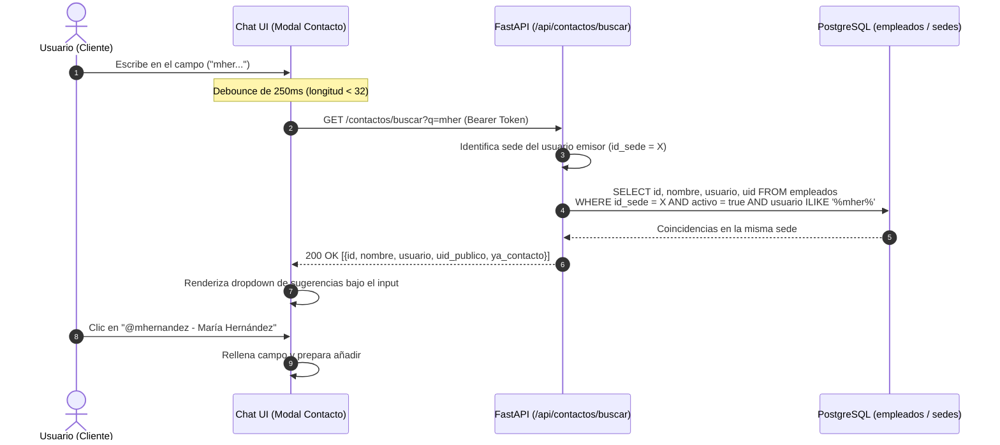
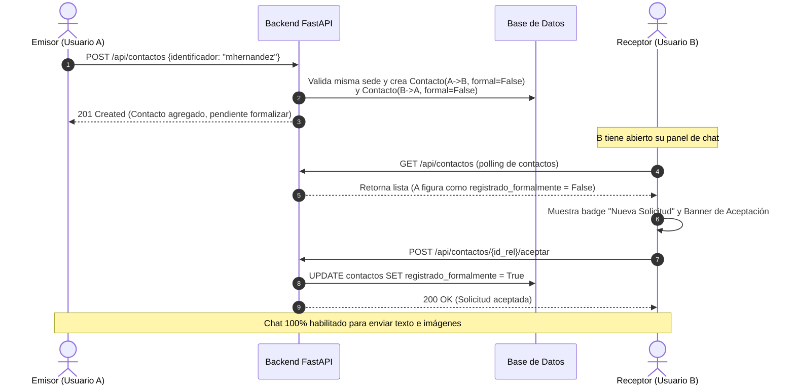

# Guía de Implementación — Servicio de Chat Intra-Sede & Gestión de Contactos
> **Proyecto:** CFS-Admin · Plataforma de Gestión y Monitoreo de Red  
> **Módulo:** Mensajería Segura & Directorio de Contactos Intra-Sede  
> **Perfil técnico:** Senior Full Stack Developer  
> **Fecha:** 2026-11-02 · **Rama:** `development`

---

## 1. Resumen de Requerimientos

La presente guía detalla el diseño de arquitectura, cambios de esquema de base de datos, contratos de API REST y componentes de interfaz para responder a los requerimientos funcionales solicitados:

1. **Búsqueda dual (Username o UID) con Autocompletado en Tiempo Real:**
   - Permitir añadir contactos tanto por su **Nombre de Usuario** (`usuario`) como por su **UID Único** (`uid_publico`).
   - Al escribir un nombre de usuario en el campo de búsqueda, desplegar un **mini-menú flotante (dropdown)** debajo del input con los usuarios coincidentes.
   - **Regla estricta de aislamiento:** La búsqueda solo mostrará usuarios de la **misma sede** que el usuario que realiza la consulta (nunca de otras sedes).
   - Si se ingresa un UID, **no** mostrar sugerencias parciales; la búsqueda por UID solo se procesa cuando el código UUID de 36 caracteres está completo.
2. **Corrección del bug de "Error al conectar con el servidor" al añadir contactos:**
   - Eliminar el falso positivo de error de conexión garantizando validación correcta en backend y cierre limpio del modal.
3. **Flujo de Solicitud de Chat y Aceptación por el Receptor:**
   - Al registrar o escribir a un contacto, el receptor recibe una **Solicitud de Chat**.
   - El receptor puede **Aceptar** la solicitud (formalizando el contacto y revelando nombre, sede y estado en línea) o **Rechazarla**.
   - Tras la aceptación, el chat queda iniciado y listo para conversar en ambos extremos.
4. **Soporte Multimedia: Envío de Texto e Imágenes:**
   - Habilitar el envío de texto plano e imágenes adjuntas (`image/png`, `image/jpeg`, `image/webp`).
   - Previsualización y renderizado responsive de imágenes dentro de las burbujas de chat.

---

## 2. Diagrama de Arquitectura y Flujos

### 2.1 Flujo de Búsqueda y Autocompletado Intra-Sede



### 2.2 Flujo de Solicitud de Chat y Aceptación



---

## 3. Modelo de Datos y Migración Alembic

### 3.1 Cambios en el Modelo de Base de Datos

#### Tabla `mensajes_chat`:
Se añade la columna `tipo` para distinguir entre mensajes de texto regular e imágenes:

```python
# backend/db/template/mensaje_chat.py
tipo: Mapped[str] = mapped_column(
    String(20), default="texto", server_default="texto", nullable=False
)
```

Valores permitidos:
- `"texto"`: Mensaje de texto estándar almacenado en `contenido`.
- `"imagen"`: Imagen codificada en formato Data-URI Base64 optimizada o URL estática almacenada en `contenido`.

#### Tabla `contactos`:
Ya cuenta con:
- `registrado_formalmente: Boolean` (por defecto `False`).
- `id_usuario: Integer` (FK empleados).
- `id_contacto: Integer` (FK empleados).
- `alias: String(100)`.

Se agrega un índice compuesto para agilizar las comprobaciones de solicitudes pendientes:
- `ix_contactos_solicitudes: (id_usuario, registrado_formalmente)`

### 3.2 Migración Alembic

Crear el archivo `backend/migrations/versions/e2f3a4b5c6d7_agregar_tipo_mensaje_chat.py`:

```python
"""agregar tipo mensaje chat

Revision ID: e2f3a4b5c6d7
Revises: d9e4a2c1b8f5
Create Date: 2026-11-02 02:00:00.000000

"""
from alembic import op
import sqlalchemy as sa

revision = 'e2f3a4b5c6d7'
down_revision = 'd9e4a2c1b8f5'
branch_labels = None
depends_on = None

def upgrade() -> None:
    op.add_column(
        'mensajes_chat',
        sa.Column('tipo', sa.String(length=20), server_default='texto', nullable=False),
    )
    op.create_index(
        op.f('ix_contactos_id_usuario_formal'),
        'contactos',
        ['id_usuario', 'registrado_formalmente'],
        unique=False,
    )

def downgrade() -> None:
    op.drop_index(op.f('ix_contactos_id_usuario_formal'), table_name='contactos')
    op.drop_column('mensajes_chat', 'tipo')
```

---

## 4. Especificación de Endpoints del Backend

### 4.1 `GET /api/contactos/buscar` — Búsqueda Dinámica Intra-Sede

> [!IMPORTANT]
> **Aislamiento Intra-Sede:** Si el usuario consultante no es `admin-g`, la consulta SQL debe restringir estrictamente los resultados a la sede del usuario: `id_sede == sede_usuario`. Jamás se debe revelar la existencia ni datos de usuarios de otras sedes.

#### Parámetros de consulta:
- `q` (string, obligatorio, mín. 2 caracteres): Término de búsqueda (username o UID).

#### Lógica de resolución:
1. Obtener la sede del usuario actual mediante `_obtenerSedeUsuario(user, db)`.
2. Si `q` tiene formato de UUID completo (36 caracteres con guiones, ej. `^[0-9a-fA-F-]{36}$`):
   - Buscar por `Empleado.uid_publico == q`.
   - Exigir coincidencia exacta.
3. Si `q` es un nombre o username (longitud < 32 caracteres):
   - Buscar coincidencias parciales con `Empleado.usuario.ilike(f"%{q}%")` o `Empleado.nombre.ilike(f"%{q}%")`.
   - **No** buscar coincidencias parciales por UID (cumple el requerimiento de no mostrar sugerencias de UID parcial).
4. Excluir al propio usuario (`Empleado.id_empleado != user.id_empleado`) y usuarios inactivos (`Empleado.activo == True`).
5. Limitar a un máximo de 8 resultados para mantener óptimo el rendimiento del dropdown.

#### Esquema de respuesta (`list[ContactoBuscarResponse]`):
```json
[
  {
    "id_empleado": 3,
    "nombre": "María Hernández",
    "usuario": "mhernandez",
    "uid_publico": "77fcf360-1f99-4688-b8f5-b98ffe24a130",
    "ya_es_contacto": false,
    "solicitud_pendiente": false
  }
]
```

---

### 4.2 `POST /api/contactos` — Añadir Contacto por Username o UID

#### Esquema de entrada Pydantic (`ContactoAgregarRequest`):
```python
class ContactoAgregarRequest(BaseModel):
    identificador: str = Field(..., min_length=2, max_length=50)
    alias: str | None = Field(None, max_length=100)
```

> [!TIP]
> **Resolución del bug de conexión:** El campo anterior exigía `uid_publico: min_length=10`. Cuando el usuario ingresaba un username corto (ej. `admin` de 5 letras), FastAPI retornaba un error de validación `HTTP 422 Unprocessable Entity` con un arreglo en `detail`. El frontend no lo formateaba bien y lanzaba la excepción `Error al conectar con el servidor`. Al unificar el campo a `identificador` con `min_length=2`, la validación pasa limpiamente.

#### Lógica de backend:
1. Buscar al empleado objetivo mediante:
   ```python
   ident = data.identificador.strip()
   target = db.scalars(
       select(Empleado).where(
           or_(Empleado.uid_publico == ident, Empleado.usuario.ilike(ident)),
           Empleado.activo == True,
       )
   ).first()
   ```
2. Validar que no sea el mismo usuario (`target.id_empleado != user.id_empleado`).
3. Validar coincidencia de sede (si no es `admin-g`).
4. Si ya existe la relación de contacto de `user -> target`:
   - Retornar la relación existente sin duplicar ni fallar (`HTTP 200`).
5. Si no existe:
   - Crear la relación emisor: `Contacto(id_usuario=user.id_empleado, id_contacto=target.id_empleado, registrado_formalmente=False)`.
   - Asegurar la relación receptor: `Contacto(id_usuario=target.id_empleado, id_contacto=user.id_empleado, registrado_formalmente=False)`.
   - Guardar y responder `HTTP 201 Created`.

---

### 4.3 `POST /api/contactos/{id_contacto_rel}/aceptar` — Aceptación de Solicitud de Chat

Permite al receptor de una solicitud de contacto formalizar el vínculo con un solo clic.

```python
@router.post("/{id_contacto_rel}/aceptar", status_code=status.HTTP_200_OK)
def _aceptarSolicitudContacto(
    id_contacto_rel: int,
    user: Annotated[Empleado, Depends(getCurrentUser)],
    db: Annotated[Session, Depends(getDb)],
):
    """Acepta la solicitud de chat y registra formalmente el contacto."""
    rel = db.get(Contacto, id_contacto_rel)
    if rel is None or rel.id_usuario != user.id_empleado:
        raise HTTPException(status_code=404, detail="Solicitud no encontrada.")

    rel.registrado_formalmente = True

    # Formalizar también la relación del emisor para habilitar el chat bidireccional
    rev = db.scalars(
        select(Contacto).where(
            Contacto.id_usuario == rel.id_contacto,
            Contacto.id_contacto == user.id_empleado,
        )
    ).first()
    if rev:
        rev.registrado_formalmente = True

    db.commit()
    return {"detalle": "Solicitud de chat aceptada exitosamente."}
```

---

### 4.4 `POST /api/chat/mensajes` — Soporte para Texto e Imágenes

#### Esquema Pydantic actualizado:
```python
class MensajeChatCreate(BaseModel):
    destinatario_id: int
    contenido: str = Field(..., min_length=1)  # Texto o Data-URI Base64
    tipo: str = Field(default="texto", pattern="^(texto|imagen)$")
```

#### Validación de imágenes:
- Si `tipo == "imagen"`:
  - Verificar que el contenido empiece por `data:image/(png|jpeg|jpg|webp|gif);base64,`.
  - Limitar el tamaño a un máximo de 2.5 MB para evitar saturar la base de datos y la red.

---

## 5. Diseño e Implementación en el Frontend

### 5.1 Estructura del Modal de Añadir Contacto (`chat.html`)

Se actualiza el modal con contenedor relativo para el dropdown de autocompletado:

```html
<!-- Modal: Agregar Contacto por Username o UID -->
<div class="modal-backdrop" id="modal-agregar-contacto" hidden role="dialog" aria-modal="true" aria-labelledby="titulo-modal-contacto">
  <div class="modal-card">
    <div class="modal-header">
      <h2 id="titulo-modal-contacto">Añadir Contacto</h2>
      <button class="modal-close" id="btn-cerrar-modal-contacto" type="button" aria-label="Cerrar modal">&times;</button>
    </div>
    <p class="modal-sub">Escribe el nombre de usuario de tu sede para ver sugerencias en vivo o ingresa el UID único completo.</p>
    
    <form id="form-agregar-contacto" novalidate autocomplete="off">
      <div class="form-group" style="position: relative;">
        <label for="input-identificador">Usuario o UID <span class="req">*</span></label>
        <input 
          type="text" 
          id="input-identificador" 
          required 
          placeholder="Ej: mhernandez o c4b182e0-2819-4a9f-8551-789a1b2c3d4e" 
          autocomplete="off"
        >
        
        <!-- Menú flotante de autocompletado en vivo -->
        <div class="autocomplete-dropdown" id="autocomplete-dropdown" hidden>
          <div class="autocomplete-loading" id="autocomplete-loading" hidden>Buscando en tu sede…</div>
          <div class="autocomplete-list" id="autocomplete-list"></div>
        </div>
      </div>

      <div class="form-group">
        <label for="input-alias">Alias local (opcional)</label>
        <input type="text" id="input-alias" placeholder="Ej: Coordinador de Turno" maxlength="100">
      </div>

      <div class="form-msg" id="msg-agregar-contacto" role="alert" hidden></div>

      <div class="modal-actions">
        <button class="ghost" id="btn-cancelar-contacto" type="button">Cancelar</button>
        <button class="btn" id="btn-submit-contacto" type="submit">Añadir Contacto</button>
      </div>
    </form>
  </div>
</div>
```

---

### 5.2 Estilos CSS del Dropdown y Mensajes con Imagen (`chat.css`)

```css
/* Menú flotante de autocompletado */
.autocomplete-dropdown {
  position: absolute;
  top: 100%;
  left: 0;
  right: 0;
  background: var(--card);
  border: 1px solid var(--line);
  border-top: 0;
  border-bottom-left-radius: 8px;
  border-bottom-right-radius: 8px;
  box-shadow: 0 10px 24px rgba(0,0,0,.25);
  max-height: 220px;
  overflow-y: auto;
  z-index: 60;
}

.autocomplete-item {
  display: flex;
  align-items: center;
  justify-content: space-between;
  padding: 10px 14px;
  cursor: pointer;
  border-bottom: 1px solid var(--line);
  transition: background .15s;
}

.autocomplete-item:last-child {
  border-bottom: 0;
}

.autocomplete-item:hover, .autocomplete-item.selected {
  background: color-mix(in srgb, var(--yellow) 15%, transparent);
}

.ac-user-info {
  display: flex;
  flex-direction: column;
}

.ac-name {
  font-weight: 700;
  font-size: 0.88rem;
  color: var(--ink);
}

.ac-user {
  font-size: 0.78rem;
  color: var(--muted);
}

.ac-tag {
  font-size: 0.72rem;
  font-weight: 700;
  padding: 2px 7px;
  border-radius: 999px;
  background: var(--okbg);
  color: var(--ok);
}

/* Burbujas de mensajes con imágenes */
.msg-bubble img.chat-img-thumb {
  max-width: 100%;
  max-height: 320px;
  border-radius: 8px;
  cursor: pointer;
  display: block;
  margin-top: 4px;
  transition: opacity .2s;
}

.msg-bubble img.chat-img-thumb:hover {
  opacity: 0.92;
}

/* Botón adjuntar imagen en barra de chat */
.btn-attach {
  display: grid;
  place-items: center;
  width: 44px;
  height: 44px;
  border-radius: 8px;
  border: 1px solid var(--line);
  background: transparent;
  font-size: 1.25rem;
  cursor: pointer;
  color: var(--muted);
  transition: all .2s;
}

.btn-attach:hover {
  border-color: var(--green);
  color: var(--ink);
}
```

---

### 5.3 Lógica JavaScript (`chat.js`)

#### A. Autocompletado en vivo (con debounce):

```javascript
let debounceTimer = null;

const inputIdent = $("#input-identificador");
const dropdown = $("#autocomplete-dropdown");
const listAc = $("#autocomplete-list");

inputIdent.addEventListener("input", (e) => {
  const val = e.target.value.trim();
  clearTimeout(debounceTimer);

  // Si está vacío o parece un UID incompleto pero largo (UUID = 36 caracteres con guiones)
  if (val.length < 2) {
    dropdown.hidden = true;
    listAc.innerHTML = "";
    return;
  }

  // Si el usuario está pegando un UUID completo (36 caracteres)
  const isFullUUID = /^[0-9a-f]{8}-[0-9a-f]{4}-[0-9a-f]{4}-[0-9a-f]{4}-[0-9a-f]{12}$/i.test(val);
  if (isFullUUID) {
    dropdown.hidden = true;
    return; // No requiere autocompletado, se añade directo
  }

  // Si tiene longitud entre 2 y 30, buscar por nombre de usuario en su misma sede
  debounceTimer = setTimeout(async () => {
    try {
      const res = await apiFetch(`/contactos/buscar?q=${encodeURIComponent(val)}`);
      if (!res || !res.ok) {
        dropdown.hidden = true;
        return;
      }
      const usuarios = await res.json();
      if (usuarios.length === 0) {
        listAc.innerHTML = `<div style="padding:10px 14px; font-size:0.82rem; color:var(--muted)">No hay coincidencias en tu sede.</div>`;
        dropdown.hidden = false;
        return;
      }

      listAc.innerHTML = usuarios.map(u => `
        <div class="autocomplete-item" data-user="${esc(u.usuario)}" data-uid="${esc(u.uid_publico)}">
          <div class="ac-user-info">
            <span class="ac-name">${esc(u.nombre)}</span>
            <span class="ac-user">@${esc(u.usuario)}</span>
          </div>
          ${u.ya_es_contacto ? '<span class="ac-tag">Ya en contactos</span>' : ''}
        </div>
      `).join("");

      listAc.querySelectorAll(".autocomplete-item").forEach(item => {
        item.addEventListener("click", () => {
          inputIdent.value = item.dataset.user;
          dropdown.hidden = true;
        });
      });

      dropdown.hidden = false;
    } catch (err) {
      dropdown.hidden = true;
    }
  }, 220);
});
```

#### B. Flujo sin fallos falsos al Añadir Contacto:

```javascript
async function guardarContacto(e) {
  e.preventDefault();
  const ident = $("#input-identificador").value.trim();
  const alias = $("#input-alias").value.trim();
  const msg = $("#msg-agregar-contacto");
  const btn = $("#btn-submit-contacto");

  if (!ident) {
    msg.className = "form-msg error";
    msg.textContent = "Ingresa el nombre de usuario o UID del contacto.";
    msg.hidden = false;
    msg.style.display = "block";
    return;
  }

  btn.disabled = true;
  btn.textContent = "Añadiendo…";
  msg.hidden = true;

  try {
    const res = await apiFetch("/contactos", {
      method: "POST",
      body: JSON.stringify({ identificador: ident, alias: alias || null }),
    });

    if (res && (res.status === 201 || res.status === 200)) {
      const nuevo = await res.json();
      msg.className = "form-msg success";
      msg.textContent = "¡Contacto añadido con éxito!";
      msg.hidden = false;
      msg.style.display = "block";

      await cargarContactos();
      const c = state.contactos.find((x) => x.id_empleado === nuevo.id_empleado);
      if (c) seleccionarContacto(c);

      setTimeout(() => {
        cerrarModalAgregarContacto();
      }, 400);
    } else {
      const err = await (res ? res.json().catch(() => ({})) : {});
      let errorMsg = "No se pudo añadir el contacto. Verifica que pertenezca a tu sede.";
      if (err.detail) {
        errorMsg = Array.isArray(err.detail) 
          ? err.detail.map(d => d.msg).join(", ") 
          : err.detail;
      }
      msg.className = "form-msg error";
      msg.textContent = errorMsg;
      msg.hidden = false;
      msg.style.display = "block";
    }
  } catch (err) {
    msg.className = "form-msg error";
    msg.textContent = "No se pudo procesar la solicitud con el servidor.";
    msg.hidden = false;
    msg.style.display = "block";
  } finally {
    btn.disabled = false;
    btn.textContent = "Añadir Contacto";
  }
}
```

#### C. Envío de Imágenes Multimedia:

```javascript
const inputImg = $("#input-chat-img");
$("#btn-adjuntar-img").addEventListener("click", () => inputImg.click());

inputImg.addEventListener("change", async (e) => {
  const file = e.target.files[0];
  if (!file || !state.contactoActivo) return;

  if (file.size > 2.5 * 1024 * 1024) {
    alert("La imagen excede el tamaño máximo permitido (2.5 MB).");
    return;
  }

  const reader = new FileReader();
  reader.onload = async () => {
    const base64Data = reader.result;
    try {
      const res = await apiFetch("/chat/mensajes", {
        method: "POST",
        body: JSON.stringify({
          destinatario_id: state.contactoActivo.id_empleado,
          contenido: base64Data,
          tipo: "imagen",
        }),
      });
      if (res && res.status === 201) {
        await cargarMensajes();
        const container = $("#chat-messages");
        if (container) container.scrollTop = container.scrollHeight;
      }
    } catch (err) {
      alert("Error al enviar la imagen.");
    }
  };
  reader.readAsDataURL(file);
});
```

---

## 6. Plan de Ejecución Paso a Paso

1. **Paso 1: Backend — Modelo & Migración Alembic**
   - Actualizar `backend/db/template/mensaje_chat.py` con `tipo: Mapped[str]`.
   - Generar la migración Alembic `e2f3a4b5c6d7_agregar_tipo_mensaje_chat.py`.
2. **Paso 2: Backend — Endpoint de Búsqueda Intra-Sede & Add Contact**
   - En `backend/config/request.py`:
     - Definir `ContactoBuscarResponse`.
     - Actualizar `ContactoAgregarRequest` (`identificador: str`).
     - Actualizar `MensajeChatCreate` y `MensajeChatResponse` con campo `tipo`.
   - En `backend/api/contactos.py`:
     - Implementar `GET /contactos/buscar` con filtro estricto por `id_sede`.
     - Actualizar `POST /contactos` para resolver tanto por `usuario` como por `uid_publico`.
     - Implementar `POST /contactos/{id}/aceptar`.
   - En `backend/api/chat.py`:
     - Actualizar `POST /chat/mensajes` para admitir `tipo == "imagen"`.
3. **Paso 3: Frontend — UI del Chat y Autocomplete**
   - En `frontend/home/chat.html`:
     - Reemplazar botón `+ UID` por `+ Añadir`.
     - Integrar input unificado y contenedor `#autocomplete-dropdown`.
     - Agregar botón `#btn-adjuntar-img` e input file en la barra de mensajes.
     - Mejorar el banner de formalización con botón explícito de **Aceptar Solicitud de Chat**.
   - En `frontend/home/chat.css`:
     - Agregar estilos para `.autocomplete-dropdown`, `.autocomplete-item`, y `.chat-img-thumb`.
   - En `frontend/home/chat.js`:
     - Implementar listener de autocompletado en vivo con debounce.
     - Corregir el bug en `guardarContacto` y asegurar cierre limpio del modal.
     - Manejar el renderizado condicional de burbujas de texto vs. imágenes.
     - Manejar la aceptación de solicitudes de chat entrantes.
4. **Paso 4: Verificación y Despliegue**
   - Validar sintaxis con `python3 -m py_compile`.
   - Aplicar migración de base de datos.
   - Ejecutar pruebas manuales y automáticas de extremo a extremo.

---

## 7. Criterios de Aceptación y Pruebas

- [ ] **Aislamiento Intra-Sede:** Un usuario de Sede A al escribir caracteres en el input solo ve usuarios de Sede A; ningún usuario de Sede B o C aparece en las sugerencias.
- [ ] **UID estricto sin sugerencias parciales:** Ingresar los primeros 10 caracteres de un UID no dispara el menú desplegable. Solo al ingresar el UUID exacto de 36 caracteres se localiza al contacto.
- [ ] **Sin falsos errores de red:** Al dar clic en "Añadir Contacto", la petición se completa, el modal se cierra fluidamente y el nuevo contacto aparece en la lista lateral.
- [ ] **Aceptación de Solicitudes:** El receptor ve el banner de solicitud pendiente y, al presionar "Aceptar", el estado pasa a formalizado y se habilita la conversación bilateral.
- [ ] **Envío de Imágenes:** Ambos participantes pueden adjuntar imágenes desde su dispositivo y visualizarlas correctamente dentro del hilo de chat.
