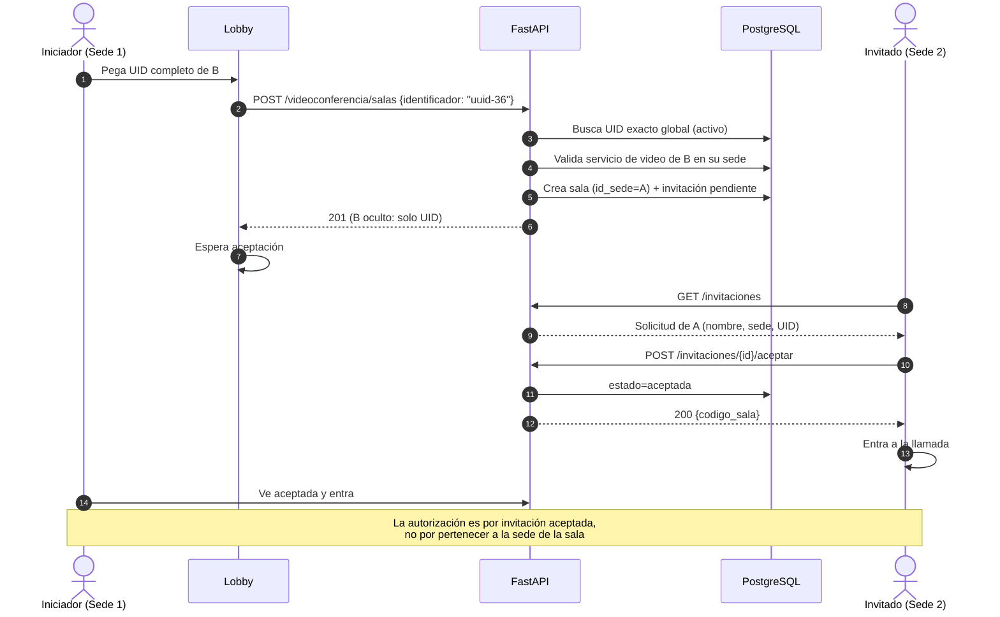
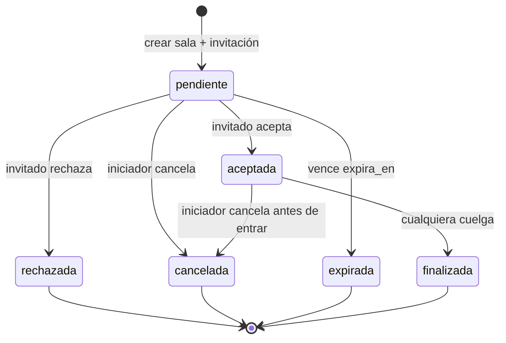

# Guía de Implementación — Servicio de Videoconferencia 1:1 con Invitaciones

> **Proyecto:** CFS-Admin · Plataforma de Gestión y Monitoreo de Red
> **Módulo:** Videoconferencia WebRTC entre clientes
> **Estado:** Implementado y validado
> **Fecha:** 2026-11-02 (implementación validada el 2026-11-03)
> **Rama de referencia:** `development`
> **Documento base:** `doc/GUIA_IMPLEMENTACION_CHAT.md`

> **Nota de implementación (2026-11-03):** la guía fue implementada en la rama actual y validada con pruebas API/WebSocket, pruebas de navegador con Selenium y `alembic check`. El diagnóstico de la sección 1 describe el estado previo a la implementación.

---

## 1. Veredicto del análisis

El servicio de videoconferencia **no es funcional entre clientes** en el estado actual. Existe un prototipo con sala, señalización WebSocket/HTTP y una interfaz de llamada, pero el flujo completo no puede completarse:

1. **No existe invitación ni bandeja de solicitudes.** El receptor nunca se entera de que alguien quiere videollamarle. `POST /videoconferencia/sala` crea una sala y el invitado solo podría entrar si alguien le comparte el código por fuera del sistema.
2. **El WebSocket no llega al backend a través de Apache.** `frontend/DockerFile` no carga `mod_proxy_wstunnel`; el handshake `ws://localhost:8080/api/videoconferencia/ws/...` responde `404`. El frontend cae al fallback HTTP.
3. **El fallback HTTP tiene "glare" (doble oferta).** Ambos navegadores ejecutan `iniciarLlamada()` al conectar y ambos envían `offer`; las sesiones WebRTC no negocian correctamente.
4. **El fallback HTTP no está dirigido ni protegido.** `GET /signal` devuelve señales de cualquier emisor y las elimina; no distingue destinatario y no valida sede en la lectura.
5. **El requisito de otras sedes por UID es imposible con el código actual.** La creación de sala, `GET /sala`, el WebSocket y `/signal` exigen que el usuario pertenezca a `sala.id_sede`. No hay entrada de UID ni excepción controlada.
6. **La autorización es por sede, no por participante.** Cualquier usuario de la misma sede que conozca el código puede consultar la sala o conectarse al WebSocket, aunque no haya sido invitado.
7. **El invitado no puede colgar.** `_finalizarSala()` solo permite al iniciador o a un `admin-g`; el botón "Finalizar" del invitado recibe `403` y la sala queda activa.
8. **La creación de sala tiene errores de validación.** Un `id_contacto` inexistente se ignora silenciosamente, se permite invitarse a uno mismo, no se comprueba que el invitado esté activo ni que la relación sea formal, y un `admin-g` sin sede usa arbitrariamente la sede `1`.
9. **Faltan TURN y HTTPS.** Solo hay STUN público y la aplicación se sirve por HTTP en `:8080`. `getUserMedia` solo funciona en `localhost` o en contexto seguro; en clientes de la LAN la cámara/micrófono quedan bloqueados. Sin TURN, las llamadas entre redes distintas suelen fallar.
10. **Ciclo de vida incompleto.** No hay expiración, limpieza de salas, notificación de finalización ni refresco de tokens en la página de llamada. El gestor de WebSocket es en memoria y asume un solo proceso.
11. **La UI no tiene el flujo necesario.** El portal crea una sala vacía, el chat solo redirige con `contacto_id`, no hay bandeja, estado de espera, entrada por UID ni manejo de aceptación/rechazo.
12. **La página de llamada no distingue roles.** Ambos peers crean oferta, no se espera a que el otro acepte, no se encola ICE antes de la descripción remota y no se maneja la desconexión.

**Conclusión:** hay piezas reutilizables (modelo de sala, endpoints base, UI de llamada, captura de medios), pero falta el flujo de invitación, la autorización por participante, la negociación WebRTC correcta y la infraestructura TLS/TURN. La solución se puede implementar sin rehacer todo el módulo.

---

## 2. Requerimientos funcionales interpretados

### 2.1 Reglas de negocio

1. **Alcance inicial 1:1.** Una sala tiene un iniciador y un invitado. Las llamadas grupales requerirían SFU/malla y quedan fuera de esta guía.
2. **Toda videollamada requiere invitación aceptada.** El receptor debe ver la solicitud en su bandeja y decidir **Aceptar** o **Rechazar**. El código de sala por sí solo no concede acceso.
3. **Misma sede:**
   - Se puede invitar desde un contacto formalizado del chat (`id_contacto`).
   - También se puede invitar por username o UID exacto de un usuario activo de la misma sede.
   - La búsqueda por username solo muestra usuarios de la misma sede.
4. **Otra sede:**
   - Solo se puede invitar usando el **UID exacto completo** (UUID de 36 caracteres).
   - No se permite buscar por username ni por prefijo de UID de otra sede.
   - El UID es el consentimiento explícito para iniciar la solicitud; la aceptación en la bandeja es el consentimiento final.
5. **Servicio habilitado en ambos extremos.** El servicio `videoconferencia` debe estar habilitado para el iniciador y para el invitado, tanto al crear la invitación como al aceptar/unirse.
6. **Aislamiento estricto.** Un usuario de otra sede no puede ver la sala, las señales ni la identidad del invitado salvo que exista una invitación aceptada. Un usuario de la misma sede que no sea participante tampoco puede entrar.
7. **Invitación persistente.** Aunque el invitado esté desconectado, la solicitud queda en la base de datos y aparece en su bandeja al volver, hasta que expire, sea rechazada o cancelada.
8. **Expiración.** Las invitaciones pendientes expiran (valor recomendado: 2 minutos configurables). Una invitación expirada no se puede aceptar.
9. **Una llamada activa por usuario.** Si el usuario ya está en una sala activa, no puede aceptar otra ni crear otra mientras no la finalice.
10. **Finalización.** Cualquiera de los dos participantes puede colgar. En una llamada 1:1 eso finaliza la sala para ambos.
11. **Privacidad entre sedes.** Antes de la aceptación, el iniciador ve del invitado solo el UID (y username si la sede es la misma). Nombre y sede completos se revelan cuando la invitación es aceptada. El invitado sí ve quién lo invita para poder decidir.
12. **Sin creación automática de contactos.** La videollamada es efímera; aceptar una invitación no crea una relación de chat ni viceversa.

### 2.2 Matriz de permisos

| Caso | ¿Permitido? | Condición |
|---|---|---|
| Misma sede, contacto formalizado | Sí | `id_contacto` con relación formal en ambos sentidos |
| Misma sede, username | Sí | Usuario activo de la misma sede y servicio de video habilitado |
| Misma sede, UID exacto | Sí | UUID completo, usuario activo y servicio habilitado |
| Otra sede, username | No | Debe devolver `404` genérico para no filtrar existencia |
| Otra sede, UID parcial | No | No se resuelven prefijos |
| Otra sede, UID exacto | Sí | UUID completo, usuario activo y servicio habilitado |
| Invitarse a sí mismo | No | `400` |
| Usuario inactivo | No | `404` |
| Servicio de video deshabilitado | No | `403` |
| Tercero de la misma sede con código | No | Solo iniciador o invitación aceptada |
| Invitado antes de aceptar | No | Solo puede ver/responder su invitación, no la sala |
| `admin-g` | Solo si es participante | No se recomienda acceso implícito al audio/video |

### 2.3 Estados

**Invitación:**

```text
pendiente ──aceptar──> aceptada ──salir/finalizar──> finalizada
    │
    ├──rechazar──> rechazada
    ├──cancelar──> cancelada
    └──expirar───> expirada
```

**Sala:**

```text
activa = true   mientras la invitación está pendiente o aceptada
activa = false  al rechazar, cancelar, expirar o finalizar
```

La sala no debe quedar `activa=true` sin una invitación pendiente o aceptada.

---

## 3. Estado actual: qué existe y qué falla

### 3.1 Backend actual

**Archivo:** `backend/api/videoconferencia.py`

| Elemento | Estado | Problema |
|---|---|---|
| `POST /videoconferencia/sala` | Parcial | Crea sala, pero no crea invitación ni notifica. `id_contacto` inválido se ignora. No valida auto-invitación, usuario activo ni contacto formal. `admin-g` usa sede `1` por defecto. |
| `GET /videoconferencia/sala/{codigo}` | Parcial | Solo valida misma sede. Cualquier usuario de la sede con el código puede entrar. Un invitado de otra sede nunca puede. |
| `POST /videoconferencia/sala/{codigo}/finalizar` | Parcial | Solo iniciador o `admin-g`. El invitado recibe `403`. No notifica a los WebSocket ni cancela invitaciones. |
| `POST /videoconferencia/sala/{codigo}/signal` | Frágil | Solo misma sede; no valida destinatario; cola global por sala. |
| `GET /videoconferencia/sala/{codigo}/signal` | Inseguro | No valida sede ni participante; devuelve y borra señales de todos los demás. |
| `WS /videoconferencia/ws/{codigo}` | Parcial | Autentica y valida sede, pero no participante; no limita a dos conexiones; retransmite texto arbitrario sin identificar emisor; no envía presencia. |
| `SalaVideoconf` | Insuficiente | Solo `id_invitado` y `activa`; no hay estado de invitación, expiración ni historial. |

**Archivo:** `backend/config/request.py`

`SalaVideoconfCreate` solo acepta `id_contacto`; no existe `identificador` ni validación de "exactamente uno". `SalaVideoconfResponse` no expone estado de invitación, rol del usuario ni nombres.

**Archivo:** `backend/db/template/sala_videoconf.py`

La sala tiene `id_sede` obligatorio, `id_iniciador`, `id_invitado` opcional y `activa`. No hay relación con invitaciones. El índice de `id_invitado` se añadió en `f3b4c5d6e7a8`.

**Base de datos actual:** `salas_videoconf` está vacía y el servicio de videoconferencia está deshabilitado para los usuarios de prueba (`mhernandez`, `cperez`, `rtest`, `aislada`). No hay datos que migrar en este entorno.

### 3.2 Frontend actual

**Archivo:** `frontend/home/videocall.js`

- En `ws.onopen` llama `crearPeerConnection()` e `iniciarLlamada()` para **ambos** participantes (`líneas 157-162`). Ambos generan `offer`: glare.
- El fallback HTTP también llama `iniciarLlamada()` en ambos lados (`líneas 184-200`).
- `procesarSenal()` no encola candidatos ICE anteriores a la descripción remota; los candidatos que llegan antes del `offer`/`answer` se pierden.
- `finalizarLlamada()` llama a `/finalizar` sin distinguir rol; el invitado recibe `403`.
- No hay refresco de token: el `apiFetch` local no maneja `401`, por lo que heartbeat, polling y reconexión fallan cuando expira el access token.
- El fallback crea un segundo `RTCPeerConnection` sin cerrar el primero y puede dejar dos conexiones activas.
- No hay estado de espera, aceptación, rechazo ni cancelación.
- Solo usa STUN público; no hay TURN ni endpoint de configuración ICE.
- El fallback de cámara usa un canvas sin audio si `getUserMedia` falla; en un entorno HTTP de LAN eso puede parecer "funcionar" sin video real.

**Archivo:** `frontend/home/videocall.html`

No hay bandeja, estado de espera, lista de invitaciones ni entrada por UID. El botón "Copiar Sala" sugiere que el código es la invitación, pero no hay ningún mecanismo de notificación.

**Archivo:** `frontend/home/usuario.js` / `usuario.html`

`btn-entrar-video` redirige a `videocall.html` sin sala ni invitado (`línea 294`). El texto del servicio dice "contactos autorizados de la sede", sin mencionar UID entre sedes.

**Archivo:** `frontend/home/chat.js`

El botón de videollamada redirige a `videocall.html?contacto_id=...` (`líneas 703-706`). Se habilita solo por `registrado_formalmente`, no por el servicio de video del contacto. No crea invitación.

### 3.3 Infraestructura actual

| Componente | Estado | Impacto |
|---|---|---|
| Apache `mod_proxy_wstunnel` | No cargado | El handshake WebSocket a través de `:8080` responde `404` (verificado). |
| HTTPS | No configurado | `getUserMedia` bloqueado en clientes LAN; solo `localhost` funciona. |
| TURN | No configurado | Llamadas entre redes/NAT poco fiables; solo STUN. |
| Gestor WebSocket | En memoria | Si se reinicia la API o se usan varios workers, se pierden salas y señales. |
| Expiración/limpieza | No existe | Salas e invitaciones zombie. |
| Límite de invitaciones | No existe | Posible spam de solicitudes. |

**Verificación realizada:** el contenedor web solo tiene cargados `proxy_module` y `proxy_http_module`; `proxy_wstunnel_module` está comentado. Una petición de upgrade a `http://localhost:8080/api/videoconferencia/ws/sala-inexistente` devuelve `404` de Uvicorn en lugar de un handshake `101`.

---

## 4. Arquitectura objetivo

### 4.1 Componentes

```text
┌─────────────────────┐        ┌─────────────────────┐
│  Portal / Chat      │        │  Bandeja de video   │
│  usuario.html       │───────▶│  videollamadas.html │
│  chat.html          │        │  (invitaciones)     │
└─────────┬───────────┘        └──────────┬──────────┘
          │                               │
          │  POST /videoconferencia/salas │
          ▼                               ▼
┌─────────────────────────────────────────────────────┐
│ FastAPI · backend/api/videoconferencia.py           │
│  - resolución same-sede / UID exacto                │
│  - invitaciones persistentes                        │
│  - autorización por participante                    │
│  - señalización WebSocket y fallback HTTP           │
└───────────────┬─────────────────────┬───────────────┘
                │                     │
                ▼                     ▼
        ┌───────────────┐     ┌───────────────┐
        │ PostgreSQL    │     │ Navegador A   │
        │ salas +       │     │ RTCPeerConn.  │
        │ invitaciones  │     └───────┬───────┘
        └───────────────┘             │ WebRTC P2P
                                      ▼
                              ┌───────────────┐
                              │ Navegador B   │
                              │ RTCPeerConn.  │
                              └───────────────┘
```

### 4.2 Flujo same-sede

```mermaid
sequenceDiagram
    autonumber
    actor A as Iniciador (Sede 1)
    participant L as Lobby / Chat
    participant API as FastAPI
    participant DB as PostgreSQL
    actor B as Invitado (Sede 1)

    A->>L: Elige contacto o escribe username/UID
    L->>API: POST /videoconferencia/salas {id_contacto | identificador}
    API->>DB: Valida sede, servicio, contacto/UID
    API->>DB: Crea sala activa + invitación pendiente (expira 2 min)
    API-->>L: 201 {codigo_sala, invitacion_id, estado: pendiente}
    L->>L: Redirige a videocall.html?codigo_sala=... (espera)

    loop Polling cada 2 s
        A->>API: GET /videoconferencia/sala/{codigo}
        API-->>A: estado_invitacion
    end

    B->>API: GET /videoconferencia/invitaciones (polling 5 s)
    API-->>B: Solicitud de A (nombre, sede, expira)
    B->>API: POST /videoconferencia/invitaciones/{id}/aceptar
    API->>DB: estado=aceptada, sala.id_invitado=B
    API-->>B: 200 {sala}
    B->>B: Redirige a videocall.html?codigo_sala=...

    A->>API: GET /sala/{codigo} → aceptada
    A->>API: WS /videoconferencia/ws/{codigo}
    B->>API: WS /videoconferencia/ws/{codigo}
    API-->>A: peer_joined
    A->>B: offer (por WebSocket)
    B->>A: answer
    A<->B: ICE candidates
    A<->B: audio/video P2P
```

### 4.3 Flujo cross-sede por UID



### 4.4 Máquina de estados de la invitación



---

## 5. Modelo de datos y migración Alembic

### 5.1 Nueva tabla `invitaciones_videoconf`

Se propone una tabla de invitaciones independiente de la sala. Esto permite bandeja, historial, estados, expiración y, a futuro, más de un invitado sin rehacer la sala.

**Archivo nuevo:** `backend/db/template/invitacion_videoconf.py`

```python
from datetime import datetime, timezone
from typing import TYPE_CHECKING

from sqlalchemy import CheckConstraint, DateTime, ForeignKey, Index, String, UniqueConstraint, func
from sqlalchemy.orm import Mapped, mapped_column, relationship

from .base import Base

if TYPE_CHECKING:
    from .empleado import Empleado
    from .sala_videoconf import SalaVideoconf


class InvitacionVideoconf(Base):
    __tablename__ = "invitaciones_videoconf"

    id: Mapped[int] = mapped_column(primary_key=True)

    id_sala: Mapped[int] = mapped_column(
        ForeignKey("salas_videoconf.id", ondelete="CASCADE"), index=True
    )
    id_invitador: Mapped[int] = mapped_column(
        ForeignKey("empleados.id_empleado", ondelete="CASCADE"), index=True
    )
    id_invitado: Mapped[int] = mapped_column(
        ForeignKey("empleados.id_empleado", ondelete="CASCADE"), index=True
    )

    estado: Mapped[str] = mapped_column(
        String(20), default="pendiente", server_default="pendiente"
    )
    creada_en: Mapped[datetime] = mapped_column(
        DateTime(timezone=True),
        default=lambda: datetime.now(timezone.utc),
        server_default=func.now(),
    )
    expira_en: Mapped[datetime] = mapped_column(DateTime(timezone=True))
    respondida_en: Mapped[datetime | None] = mapped_column(
        DateTime(timezone=True), nullable=True
    )

    sala: Mapped["SalaVideoconf"] = relationship(back_populates="invitaciones")
    invitador: Mapped["Empleado"] = relationship(foreign_keys=[id_invitador])
    invitado: Mapped["Empleado"] = relationship(foreign_keys=[id_invitado])

    __table_args__ = (
        CheckConstraint("id_invitador <> id_invitado", name="invitacion_no_auto"),
        CheckConstraint(
            "estado IN ('pendiente','aceptada','rechazada','cancelada','expirada','finalizada')",
            name="invitacion_estado_valido",
        ),
        UniqueConstraint(
            "id_sala", "id_invitado", name="uq_invitaciones_sala_invitado"
        ),
        Index("ix_invitaciones_invitado_estado", "id_invitado", "estado"),
        Index("ix_invitaciones_invitador_estado", "id_invitador", "estado"),
    )
```

> **Nota:** `id_invitador` se denormaliza desde la sala para facilitar la bandeja de enviadas y el índice parcial de "una pendiente por par". La sala ya tiene `id_iniciador`; al crear la invitación ambos deben coincidir.

### 5.2 Cambios en `SalaVideoconf`

**Archivo:** `backend/db/template/sala_videoconf.py`

Añadir la relación inversa:

```python
if TYPE_CHECKING:
    from .invitacion_videoconf import InvitacionVideoconf

class SalaVideoconf(Base):
    # ... campos existentes ...

    invitaciones: Mapped[list["InvitacionVideoconf"]] = relationship(
        back_populates="sala",
        cascade="all, delete-orphan",
        order_by="InvitacionVideoconf.creada_en",
    )
```

No es necesario cambiar `id_sede` ni `activa`. `id_sede` seguirá siendo la sede del iniciador (o la del invitado si el iniciador es `admin-g` sin sede). La autorización cross-sede se resuelve con la invitación aceptada, no con `id_sede`.

### 5.3 Registro del modelo

**Archivo:** `backend/db/template/__init__.py`

Añadir la importación para que Alembic y SQLAlchemy registren la tabla:

```python
from . import (
    base, rol, sede, empleado, servicio_red, dispositivo_red,
    refresh_token, servicio_usuario, contacto, mensaje_chat,
    sala_videoconf, invitacion_videoconf,
)
```

### 5.4 Migración

**Archivo nuevo:** `backend/migrations/versions/a4b5c6d7e8f9_agregar_invitaciones_videoconf.py`

`down_revision = 'f3b4c5d6e7a8'` (head actual).

Esquema de la migración:

```python
"""agregar invitaciones videoconferencia

Revision ID: a4b5c6d7e8f9
Revises: f3b4c5d6e7a8
Create Date: 2026-11-02 ...
"""
from typing import Sequence, Union
import sqlalchemy as sa
from alembic import op

revision: str = "a4b5c6d7e8f9"
down_revision: Union[str, None] = "f3b4c5d6e7a8"
branch_labels = None
depends_on = None


def upgrade() -> None:
    op.create_table(
        "invitaciones_videoconf",
        sa.Column("id", sa.Integer(), nullable=False),
        sa.Column("id_sala", sa.Integer(), nullable=False),
        sa.Column("id_invitador", sa.Integer(), nullable=False),
        sa.Column("id_invitado", sa.Integer(), nullable=False),
        sa.Column("estado", sa.String(length=20), server_default="pendiente", nullable=False),
        sa.Column("creada_en", sa.DateTime(timezone=True), server_default=sa.func.now(), nullable=False),
        sa.Column("expira_en", sa.DateTime(timezone=True), nullable=False),
        sa.Column("respondida_en", sa.DateTime(timezone=True), nullable=True),
        sa.CheckConstraint("id_invitador <> id_invitado", name="invitacion_no_auto"),
        sa.CheckConstraint(
            "estado IN ('pendiente','aceptada','rechazada','cancelada','expirada','finalizada')",
            name="invitacion_estado_valido",
        ),
        sa.ForeignKeyConstraint(
            ["id_sala"], ["salas_videoconf.id"],
            name=op.f("fk_invitaciones_videoconf_id_sala_salas_videoconf"),
            ondelete="CASCADE",
        ),
        sa.ForeignKeyConstraint(
            ["id_invitador"], ["empleados.id_empleado"],
            name=op.f("fk_invitaciones_videoconf_id_invitador_empleados"),
            ondelete="CASCADE",
        ),
        sa.ForeignKeyConstraint(
            ["id_invitado"], ["empleados.id_empleado"],
            name=op.f("fk_invitaciones_videoconf_id_invitado_empleados"),
            ondelete="CASCADE",
        ),
        sa.PrimaryKeyConstraint("id", name=op.f("pk_invitaciones_videoconf")),
        sa.UniqueConstraint("id_sala", "id_invitado", name="uq_invitaciones_sala_invitado"),
    )
    op.create_index("ix_invitaciones_videoconf_id_sala", "invitaciones_videoconf", ["id_sala"])
    op.create_index("ix_invitaciones_videoconf_id_invitador", "invitaciones_videoconf", ["id_invitador"])
    op.create_index("ix_invitaciones_videoconf_id_invitado", "invitaciones_videoconf", ["id_invitado"])
    op.create_index("ix_invitaciones_invitado_estado", "invitaciones_videoconf", ["id_invitado", "estado"])
    op.create_index("ix_invitaciones_invitador_estado", "invitaciones_videoconf", ["id_invitador", "estado"])
    op.create_index(
        "uq_invitaciones_pendientes_par",
        "invitaciones_videoconf",
        ["id_invitador", "id_invitado"],
        unique=True,
        postgresql_where=sa.text("estado = 'pendiente'"),
    )

    # Limpieza de salas antiguas sin invitación: no deben quedar accesibles.
    op.execute("UPDATE salas_videoconf SET activa = false WHERE activa = true")


def downgrade() -> None:
    op.drop_index("uq_invitaciones_pendientes_par", table_name="invitaciones_videoconf")
    op.drop_index("ix_invitaciones_invitador_estado", table_name="invitaciones_videoconf")
    op.drop_index("ix_invitaciones_invitado_estado", table_name="invitaciones_videoconf")
    op.drop_index("ix_invitaciones_videoconf_id_invitado", table_name="invitaciones_videoconf")
    op.drop_index("ix_invitaciones_videoconf_id_invitador", table_name="invitaciones_videoconf")
    op.drop_index("ix_invitaciones_videoconf_id_sala", table_name="invitaciones_videoconf")
    op.drop_table("invitaciones_videoconf")
```

**Decisión sobre salas existentes:** como en este entorno `salas_videoconf` está vacía, no hay backfill. En producción, si hubiera salas activas, se deben cerrar en una ventana de mantenimiento. Alternativa conservadora: crear invitaciones `aceptada` para salas con `id_invitado` y `expira_en` futuro. No se recomienda mezclar salas antiguas sin invitación con el nuevo modelo.

### 5.5 Configuración asociada

Añadir a `backend/config/load.py`:

```python
class Configuration(BaseSettings):
    # ...
    video_invitacion_expira_minutos: int = 2
    stun_urls: list[str] = ["stun:stun.l.google.com:19302"]
    turn_url: str | None = None
    turn_username: str | None = None
    turn_credential: str | None = None
```

Y a `examples/.env.example` y al `.env` local:

```dotenv
VIDEO_INVITACION_EXPIRA_MINUTOS=2
STUN_URLS=["stun:stun.l.google.com:19302"]
TURN_URL=
TURN_USERNAME=
TURN_CREDENTIAL=
```

`compose.yaml` debe pasar esas variables al servicio `api` (basta con `env_file: .env` para las que ya estén, pero se recomienda declararlas explícitamente para que no se pierdan al desplegar):

```yaml
environment:
  VIDEO_INVITACION_EXPIRA_MINUTOS: ${VIDEO_INVITACION_EXPIRA_MINUTOS:-2}
  STUN_URLS: ${STUN_URLS:-["stun:stun.l.google.com:19302"]}
  TURN_URL: ${TURN_URL:-}
  TURN_USERNAME: ${TURN_USERNAME:-}
  TURN_CREDENTIAL: ${TURN_CREDENTIAL:-}
```

**Verificación:** tras la migración, `alembic check` debe responder `No new upgrade operations detected.` y el round-trip `upgrade`/`downgrade` de la nueva revisión debe funcionar.

---

## 6. Esquemas Pydantic

**Archivo:** `backend/config/request.py`

### 6.1 Creación de sala / invitación

```python
class SalaVideoconfCreate(BaseModel):
    id_contacto: int | None = None
    identificador: str | None = Field(None, min_length=2, max_length=50)

    @model_validator(mode="after")
    def validar_identificador(self):
        if (self.id_contacto is None) == (self.identificador is None):
            raise ValueError("Debes indicar id_contacto o identificador, pero no ambos.")
        return self
```

- `id_contacto` es el **ID de empleado** del contacto (no el ID de la relación `contactos.id`), manteniendo la semántica actual del frontend.
- `identificador` admite username o UID exacto.
- Si se envía un UID completo, se resuelve globalmente; si es username, solo same-sede.

### 6.2 Respuesta de sala

```python
class SalaVideoconfResponse(BaseModel):
    codigo_sala: str
    id_sala: int
    id_sede: int
    id_iniciador: int
    id_invitado: int | None = None
    nombre_iniciador: str | None = None
    nombre_invitado: str | None = None
    usuario_invitado: str | None = None
    uid_invitado: str | None = None
    estado_invitacion: str | None = None
    invitacion_id: int | None = None
    expira_en: datetime | None = None
    activa: bool
    es_iniciador: bool = False
    puede_entrar: bool = False
```

Reglas de privacidad:

- Si el solicitante es el iniciador y la invitación está pendiente:
  - same-sede: puede ver `nombre_invitado`, `usuario_invitado`, `uid_invitado`.
  - cross-sede: solo `uid_invitado` (y quizá prefijo); `nombre_invitado` y `usuario_invitado` quedan en `None`.
- Si la invitación está aceptada: se revelan nombre y sede del otro participante.
- Si el solicitante es el invitado: ve los datos del iniciador desde la invitación.

### 6.3 Respuesta de invitación (bandeja)

```python
class InvitacionVideoconfResponse(BaseModel):
    id: int
    id_sala: int
    codigo_sala: str
    id_invitador: int
    nombre_invitador: str | None = None
    usuario_invitador: str | None = None
    uid_invitador: str | None = None
    sede_invitador: str | None = None
    id_invitado: int
    nombre_invitado: str | None = None
    usuario_invitado: str | None = None
    uid_invitado: str | None = None
    estado: str
    creada_en: datetime
    expira_en: datetime
    puede_aceptar: bool = False
    es_recibida: bool = True
```

Para la bandeja de enviadas se puede reutilizar el mismo esquema, con `es_recibida=False` y los datos del invitado enmascarados si la invitación sigue pendiente y es cross-sede.

### 6.4 ICE

```python
class IceServerConfig(BaseModel):
    urls: list[str]
    username: str | None = None
    credential: str | None = None

class IceConfigResponse(BaseModel):
    iceServers: list[IceServerConfig]
```

### 6.5 Señalización HTTP (fallback)

```python
class SenalVideoconfCreate(BaseModel):
    tipo: str = Field(..., pattern="^(offer|answer|candidate)$")
    para_id: int
    sdp: dict | None = None
    candidate: dict | None = None
```

El servidor debe ignorar cualquier `de_id` enviado por el cliente y usar siempre `user.id_empleado`.

---

## 7. Contratos de API

Prefijo: `/api/videoconferencia`.

### 7.1 `POST /salas` — Crear sala e invitación

**Body:** `SalaVideoconfCreate`.

**Lógica:**

1. Validar que el usuario tenga sede (salvo `admin-g`) y servicio de video habilitado.
2. Resolver invitado:
   - `id_contacto`: empleado activo, misma sede, relación `Contacto` formalizada.
   - `identificador` UUID completo: búsqueda global exacta, usuario activo.
   - `identificador` username: búsqueda exacta por username, solo misma sede, usuario activo.
   - Rechazar auto-invitación.
3. Validar servicio de video del invitado en **su propia sede**.
4. Validar que el iniciador no tenga otra sala activa o invitación pendiente.
5. Validar que no exista una invitación pendiente del mismo iniciador al mismo invitado.
6. Determinar `id_sede` de la sala:
   - sede del iniciador, si existe;
   - si el iniciador es `admin-g` sin sede, sede del invitado;
   - si no se puede determinar, `400`.
7. Crear `SalaVideoconf` y `InvitacionVideoconf` en la misma transacción.
   - `estado = "pendiente"`.
   - `expira_en = now + video_invitacion_expira_minutos`.
8. Devolver `201` con `SalaVideoconfResponse`.
9. Aplicar rate limit (por ejemplo, `10/minute` por usuario/IP).

**Errores:**

| Código | Caso |
|---|---|
| `400` | Ni `id_contacto` ni `identificador`; ambos; auto-invitación; sin sede determinable |
| `403` | Servicio de video deshabilitado; contacto no formalizado; username de otra sede |
| `404` | Usuario/contacto no encontrado, inactivo, o UID inexistente |
| `409` | Sala activa/pendiente existente; invitación pendiente duplicada |
| `422` | Formato inválido |

> **Nota de compatibilidad:** se puede mantener `POST /sala` como alias del nuevo `POST /salas` durante una transición, pero el frontend debe migrar al endpoint nuevo.

### 7.2 `GET /invitaciones` — Bandeja

**Query params:**

- `tipo`: `recibidas` (default) o `enviadas`.
- `estado`: `pendiente` (default), `aceptada`, `rechazada`, `cancelada`, `expirada`, `finalizada`, `todas`.

**Lógica:**

1. Limpiar invitaciones vencidas (`pendiente` con `expira_en <= now`) y marcar sus salas inactivas.
2. Si `tipo=recibidas`, filtrar `id_invitado == user.id_empleado`.
3. Si `tipo=enviadas`, filtrar `id_invitador == user.id_empleado`.
4. Ordenar por `creada_en DESC`.
5. Incluir datos del iniciador y de la sala.
6. Para las recibidas, `puede_aceptar=True` solo si está pendiente, no vencida, la sala está activa, el servicio de video del usuario está habilitado y no tiene otra llamada activa.

**Respuesta:** `list[InvitacionVideoconfResponse]`.

### 7.3 `GET /invitaciones/{id}` — Detalle

- Solo el iniciador o el invitado pueden consultarla.
- Devuelve el mismo esquema.
- `404` si no existe o no pertenece al usuario.

### 7.4 `POST /invitaciones/{id}/aceptar`

**Lógica transaccional:**

1. Cargar la invitación con `with_for_update()`.
2. Verificar `id_invitado == user.id_empleado`.
3. Verificar `estado == "pendiente"`.
4. Verificar `expira_en > now`.
5. Verificar que la sala siga activa y que el iniciador siga activo.
6. Verificar servicio de video de ambos.
7. Verificar que el usuario no tenga otra llamada activa.
8. Actualizar:
   - `estado = "aceptada"`;
   - `respondida_en = now`;
   - `sala.id_invitado = user.id_empleado`;
   - `sala.activa = True`.
9. Hacer commit.
10. Devolver `200` con `SalaVideoconfResponse` y `puede_entrar=True`.

**Errores:** `403` (no es el invitado / servicio deshabilitado), `404`, `409` (ya respondida / llamada activa), `410` (expirada), `409` si la sala ya no está activa.

### 7.5 `POST /invitaciones/{id}/rechazar`

1. Verificar que sea el invitado y que esté pendiente.
2. `estado = "rechazada"`, `respondida_en = now`.
3. Si la sala no tiene otra invitación aceptada, `sala.activa = False`.
4. Notificar por WebSocket si el iniciador está conectado (`invitacion_rechazada`).
5. Devolver `200`.

### 7.6 `POST /salas/{codigo}/cancelar`

- Solo el iniciador.
- Cancela todas las invitaciones pendientes de la sala (`cancelada`).
- Marca la sala inactiva.
- Notifica a los invitados conectados (`sala_cancelada`).
- `200`.

### 7.7 `GET /salas/{codigo}` — Estado para participantes

- Solo iniciador o invitado con invitación aceptada.
- Limpia expiración.
- Devuelve `SalaVideoconfResponse` con `estado_invitacion`, `es_iniciador`, `puede_entrar`.
- El iniciador puede consultarla mientras espera; el invitado la consulta después de aceptar.
- Un no participante recibe `404` (no revelar existencia).

### 7.8 `POST /salas/{codigo}/salir`

- Solo participante.
- En 1:1, finaliza la sala:
  - `sala.activa = False`;
  - invitaciones aceptadas → `finalizada`;
  - invitaciones pendientes → `cancelada`;
  - notifica `sala_finalizada` por WebSocket y cierra las conexiones de la sala.
- `200`.
- Mantener `POST /salas/{codigo}/finalizar` como alias temporal para no romper clientes viejos, pero corregir su autorización para incluir al invitado.

### 7.9 `GET /ice` — Configuración ICE

Devuelve:

```json
{
  "iceServers": [
    { "urls": ["stun:stun.l.google.com:19302"] },
    {
      "urls": ["turn:turn.example.com:3478"],
      "username": "usuario",
      "credential": "secreto"
    }
  ]
}
```

- Requiere autenticación.
- Si no hay TURN configurado, devuelve solo STUN y un aviso en logs (no en la respuesta).
- El frontend debe usar esta respuesta en lugar de la constante `ICE_SERVERS`.

### 7.10 WebSocket

`WS /api/videoconferencia/ws/{codigo_sala}?token=<access_token>`

- Validar token, usuario activo, sala activa y participación (iniciador o invitación aceptada).
- Validar servicio de video.
- Máximo dos conexiones por sala.
- Si la sala ya tiene dos conexiones, cerrar con código `4005`.
- Al conectar, enviar `sala_info` con rol y datos del otro participante (si está).
- Al entrar el segundo, enviar `peer_joined` al primero.
- Retransmitir solo mensajes `offer`, `answer`, `candidate`, con remitente derivado del servidor.
- El invitado no puede enviar `offer`; solo el iniciador.
- Cerrar y notificar al desconectar.
- Añadir `ping`/`pong` de aplicación cada 20-30 s.

**Protocolo recomendado:**

```json
{ "type": "sala_info", "es_iniciador": true, "peer_id": null, "estado": "aceptada" }
{ "type": "peer_joined", "peer_id": 3 }
{ "type": "offer", "from": 2, "sdp": { "type": "offer", "sdp": "..." } }
{ "type": "answer", "from": 3, "sdp": { "type": "answer", "sdp": "..." } }
{ "type": "candidate", "from": 2, "candidate": { ... } }
{ "type": "peer_left", "peer_id": 3 }
{ "type": "sala_finalizada", "motivo": "colgo_iniciador" }
{ "type": "error", "detail": "..." }
```

### 7.11 Fallback HTTP

Si el WebSocket falla tras varios reintentos:

- `POST /salas/{codigo}/signal` con `SenalVideoconfCreate`.
  - El servidor deriva `de_id` del token.
  - Valida que `para_id` sea el otro participante.
  - Guarda la señal en una cola dirigida al destinatario.
  - Límite de 50 señales por sala; tamaño máximo 64 KB.
- `GET /salas/{codigo}/signal`
  - Devuelve solo las señales dirigidas al usuario y las elimina.
  - Devuelve también `sala_activa` y `peer_conectado` si se puede determinar.
  - Valida participación y servicio.
- El iniciador es el único que genera `offer`; el invitado solo responde.
- El fallback no debe usarse como camino principal si el WebSocket ya funciona.

---

## 8. Lógica backend y señalización

### 8.1 Organización y helpers

Se recomienda mantener el módulo en `backend/api/videoconferencia.py`, extrayendo solo los helpers de sede a un módulo compartido (`backend/core/usuarios.py`) para no duplicar la lógica que ya existe en `contactos.py`.

| Helper | Responsabilidad |
|---|---|
| `_obtenerSedeUsuario(emp, db)` | Sede principal del empleado (`Tecnico.id_sede` / `UsuarioSede.id_sede`), no la de `servicios_usuario`. Reutilizar el de `contactos.py`. |
| `_obtenerIdsEmpleadosDeSede(id_sede, db)` | Filtrar búsquedas por username a la misma sede. Reutilizar el de `contactos.py`. |
| `_tieneServicioVideo(emp, db)` | Buscar `ServicioUsuario(tipo_servicio="videoconferencia", habilitado=True)` en la sede propia del empleado. No inferir la sede desde el servicio. |
| `_resolverInvitado(data, user, db)` | Resolver `id_contacto` o `identificador` con las reglas de la sección 2. |
| `_limpiarInvitacionesVencidas(db, id_sala=None)` | Marcar `expirada` y desactivar salas sin invitación aceptada. |
| `_participanteAutorizado(sala, user, db, exigir_aceptada=True)` | Verificar que el usuario sea iniciador o invitado con invitación aceptada. |

**Cambio importante respecto al código actual:** `_tieneServicioVideo` devuelve `True` para cualquier `admin-g`. Para videoconferencia se recomienda **exigir el servicio también a `admin-g`** o, como mínimo, no darle acceso implícito a salas ajenas. El acceso de un administrador debe ser una decisión explícita (ver sección 13).

### 8.2 Resolución del invitado

```python
PATRON_UUID = re.compile(
    r"^[0-9a-fA-F]{8}-[0-9a-fA-F]{4}-[0-9a-fA-F]{4}-"
    r"[0-9a-fA-F]{4}-[0-9a-fA-F]{12}$"
)

def _resolverInvitado(data, user, db) -> Empleado:
    if data.id_contacto is not None:
        invitado = db.get(Empleado, data.id_contacto)
        if invitado is None or not invitado.activo:
            raise HTTPException(404, "Usuario no encontrado.")
        if _obtenerSedeUsuario(invitado, db) != _obtenerSedeUsuario(user, db):
            raise HTTPException(403, "Solo puedes invitar contactos de tu sede.")
        relacion = db.scalars(
            select(Contacto).where(
                Contacto.id_usuario == user.id_empleado,
                Contacto.id_contacto == invitado.id_empleado,
                Contacto.registrado_formalmente.is_(True),
            )
        ).first()
        if relacion is None:
            raise HTTPException(403, "El contacto no está formalizado.")
        return invitado

    ident = (data.identificador or "").strip()

    if PATRON_UUID.match(ident):
        # UID completo: búsqueda global exacta, permite otra sede.
        invitado = db.scalars(
            select(Empleado).where(
                Empleado.uid_publico == ident,
                Empleado.activo.is_(True),
            )
        ).first()
    else:
        # Username: solo misma sede, coincidencia exacta (no parcial).
        ids_sede = _obtenerIdsEmpleadosDeSede(_obtenerSedeUsuario(user, db), db)
        invitado = db.scalars(
            select(Empleado).where(
                func.lower(Empleado.usuario) == ident.lower(),
                Empleado.activo.is_(True),
                Empleado.id_empleado.in_(ids_sede),
            )
        ).first()

    if invitado is None:
        # 404 genérico: no revelar si el UID existe en otra sede.
        raise HTTPException(404, "Usuario no encontrado.")
    if invitado.id_empleado == user.id_empleado:
        raise HTTPException(400, "No puedes invitarte a ti mismo.")
    if not _tieneServicioVideo(invitado, db):
        raise HTTPException(403, "El usuario no tiene habilitada la videoconferencia.")
    return invitado
```

Reglas adicionales:

- Si el término contiene guiones pero no es un UUID completo, responder `422` o `404` sin buscar por prefijo.
- Un username de otra sede devuelve el mismo `404` que un username inexistente.
- El UID de un usuario inactivo también devuelve `404`.
- `id_contacto` se interpreta como **`id_empleado`**, igual que hoy. Documentarlo en el esquema para evitar confusiones con `contactos.id`.

### 8.3 Creación transaccional de sala e invitación

```python
@router.post("/salas", response_model=SalaVideoconfResponse, status_code=201)
@limiter.limit("10/minute")
def _crearSala(request: Request, data: SalaVideoconfCreate, user=..., db=...):
    if not _tieneServicioVideo(user, db):
        raise HTTPException(403, "Tu servicio de videoconferencia no está habilitado.")

    sede_user = _obtenerSedeUsuario(user, db)
    if sede_user is None and obtenerTipoAdmin(user) != "admin-g":
        raise HTTPException(400, "No tienes una sede asignada.")

    invitado = _resolverInvitado(data, user, db)
    sede_invitado = _obtenerSedeUsuario(invitado, db)
    id_sede_sala = sede_user or sede_invitado
    if id_sede_sala is None:
        raise HTTPException(400, "No se pudo determinar la sede de la sala.")

    # Una llamada activa por usuario (solo invitaciones aceptadas).
    if _tieneLlamadaActiva(user.id_empleado, db):
        raise HTTPException(409, "Ya tienes una videollamada activa.")

    # Evitar spam: una pendiente saliente al mismo invitado.
    duplicada = db.scalars(
        select(InvitacionVideoconf).where(
            InvitacionVideoconf.id_invitador == user.id_empleado,
            InvitacionVideoconf.id_invitado == invitado.id_empleado,
            InvitacionVideoconf.estado == "pendiente",
        )
    ).first()
    if duplicada is not None:
        raise HTTPException(409, "Ya existe una invitación pendiente para este usuario.")

    ahora = datetime.now(timezone.utc)
    sala = SalaVideoconf(
        codigo_sala=str(uuid.uuid4()),
        id_sede=id_sede_sala,
        id_iniciador=user.id_empleado,
        id_invitado=invitado.id_empleado,
        activa=True,
    )
    db.add(sala)
    db.flush()  # obtener sala.id sin commit

    invitacion = InvitacionVideoconf(
        id_sala=sala.id,
        id_invitador=user.id_empleado,
        id_invitado=invitado.id_empleado,
        estado="pendiente",
        creada_en=ahora,
        expira_en=ahora + timedelta(minutes=CONFIG.video_invitacion_expira_minutos),
    )
    db.add(invitacion)

    try:
        db.commit()
    except IntegrityError:
        db.rollback()
        raise HTTPException(409, "Ya existe una invitación pendiente para este usuario.")

    db.refresh(sala)
    db.refresh(invitacion)
    return _serializarSala(sala, invitacion, user, db)
```

**Por qué `flush()` y no `commit()` intermedio:** la sala y la invitación deben nacer en la misma transacción. Si falla la invitación, no debe quedar una sala activa sin bandeja.

**Excepción de carrera:** el índice único parcial `uq_invitaciones_pendientes_par` protege contra dos creadores concurrentes; el `IntegrityError` se traduce a `409`.

### 8.4 Aceptar, rechazar, cancelar y salir

**Aceptar** debe serializar por invitado para que dos invitaciones simultáneas no terminen ambas aceptadas:

```python
@router.post("/invitaciones/{id_invitacion}/aceptar")
def _aceptarInvitacion(id_invitacion: int, user=..., db=...):
    # Bloquea la fila del empleado: serializa aceptaciones concurrentes.
    db.execute(select(Empleado.id_empleado)
               .where(Empleado.id_empleado == user.id_empleado)
               .with_for_update())

    inv = db.scalars(
        select(InvitacionVideoconf)
        .where(InvitacionVideoconf.id == id_invitacion)
        .with_for_update()
    ).first()
    if inv is None or inv.id_invitado != user.id_empleado:
        raise HTTPException(404, "Invitación no encontrada.")

    ahora = datetime.now(timezone.utc)
    if inv.estado == "pendiente" and inv.expira_en <= ahora:
        inv.estado = "expirada"
        inv.sala.activa = False
        db.commit()
        raise HTTPException(410, "La invitación expiró.")

    if inv.estado != "pendiente":
        raise HTTPException(409, f"La invitación ya está {inv.estado}.")
    if not inv.sala.activa:
        raise HTTPException(409, "La sala ya no está activa.")
    if not _tieneServicioVideo(user, db) or not _tieneServicioVideo(inv.invitador, db):
        raise HTTPException(403, "La videoconferencia no está habilitada para ambos usuarios.")
    if _tieneLlamadaActiva(user.id_empleado, db):
        raise HTTPException(409, "Ya tienes otra videollamada activa.")

    inv.estado = "aceptada"
    inv.respondida_en = ahora
    inv.sala.id_invitado = user.id_empleado
    inv.sala.activa = True
    db.commit()
    return _serializarSala(inv.sala, inv, user, db)
```

**Rechazar:** validar invitado y estado `pendiente`; marcar `rechazada`; si la sala no tiene otra invitación aceptada, `activa=False`. Notificar por WebSocket.

**Cancelar:** solo el iniciador; marcar `cancelada` todas las pendientes de la sala; `activa=False`; notificar.

**Salir/colgar:** cualquier participante (iniciador o invitado con invitación aceptada). En 1:1:

```python
inv.estado = "finalizada"
sala.activa = False
# Las pendientes restantes pasan a "cancelada".
```

Notificar `sala_finalizada` por WebSocket y cerrar las conexiones de la sala. Mantener `/finalizar` como alias temporal, pero corrigiendo la autorización para incluir al invitado.

### 8.5 Gestor WebSocket

El gestor actual (`room -> list[WebSocket]`) no permite dirigir mensajes ni saber quién es quién. Rediseñarlo:

```python
class ConnectionManager:
    def __init__(self):
        # codigo_sala -> {id_empleado: WebSocket}
        self.rooms: dict[str, dict[int, WebSocket]] = {}

    async def connect(self, codigo: str, user_id: int, ws: WebSocket) -> bool:
        await ws.accept()
        room = self.rooms.setdefault(codigo, {})
        if user_id in room or len(room) >= 2:
            await ws.close(code=4005, reason="Sala completa.")
            return False
        room[user_id] = ws
        return True

    def peer_of(self, codigo: str, user_id: int) -> int | None:
        for other in self.rooms.get(codigo, {}):
            if other != user_id:
                return other
        return None

    async def send_to(self, codigo: str, user_id: int, payload: dict) -> None:
        ws = self.rooms.get(codigo, {}).get(user_id)
        if ws is not None:
            try:
                await ws.send_json(payload)
            except Exception:
                pass
```

Reglas del endpoint:

1. Validar token, usuario activo, servicio de video, sala activa y participación con invitación aceptada (no basta `sala.id_invitado`).
2. Rechazar la tercera conexión y las conexiones duplicadas del mismo usuario (o cerrar la anterior).
3. Al conectar, enviar `sala_info` con `es_iniciador`, `peer_id` y `estado`.
4. Si ya hay dos, enviar `peer_joined` a ambos (o solo al que ya estaba).
5. Reenviar solo `offer`, `answer`, `candidate`. **El servidor inyecta `from`**; ignora cualquier `from` del cliente.
6. Solo el iniciador puede enviar `offer`; si el invitado lo intenta, responder `error` y no reenviar.
7. Al desconectar, enviar `peer_left` y, si la llamada estaba aceptada, finalizar la sala (o dar una ventana de reconexión de 15-30 s; ver sección 13).
8. `ping`/`pong` de aplicación cada 25 s para detectar conexiones muertas.

**Limitación:** el gestor es en memoria. Funciona con el despliegue actual de un solo worker (`cfs-app.py` llama a `uvicorn.run` sin `workers`). Si se escala horizontalmente, se necesita Redis pub/sub o sesiones sticky. No introducir varios workers sin resolver esto.

### 8.6 Negociación WebRTC correcta

El error principal del frontend actual es que **ambos** lados crean oferta. El flujo debe ser:

```text
Iniciador                         Invitado
   │                                 │
   │── espera aceptación ───────────▶│
   │                                 │ acepta
   │◀───────── peer_joined ──────────│
   │                                 │
   │── offer ───────────────────────▶│
   │◀──────────────────── answer ────│
   │◀────────── candidate ───────────│
   │─────────── candidate ──────────▶│
```

- El **iniciador** es el único que llama `createOffer()`.
- El **invitado** espera `offer` y responde con `answer`.
- Si se usa el patrón *perfect negotiation*, el invitado es `polite=true` y el iniciador `polite=false`. Para 1:1 sin renegociación compleja, basta con roles explícitos.
- Los candidatos ICE que lleguen antes de `setRemoteDescription` se guardan en una cola y se aplican después.
- La oferta se crea **después** de tener el stream local y de que el otro peer esté presente. Si `getUserMedia` tarda, no enviar la oferta antes.
- Si `connectionState` pasa a `failed`, el iniciador puede hacer `restartIce()` y generar una nueva oferta; el invitado solo responde.
- No crear un segundo `RTCPeerConnection` al caer al fallback: reutilizar el existente o cerrarlo antes de crear otro.

### 8.7 Fallback HTTP dirigido

Mientras el WebSocket no funcione (o como respaldo), el fallback debe:

- Derivar `de_id` del token, nunca del cuerpo.
- Exigir `para_id` igual al otro participante.
- Guardar la señal en una cola por destinatario: `codigo_sala -> {para_id: [señales]}`.
- Devolver en `GET` solo las señales dirigidas al usuario autenticado.
- Validar participación y servicio en lectura y escritura.
- Limitar a 50 señales y 64 KB por señal.
- Mantener la regla de una sola oferta (solo iniciador).

```python
manager.fallback_signals.setdefault(codigo, {}).setdefault(para_id, []).append({
    "de_id": user.id_empleado,
    "tipo": data.tipo,
    "sdp": data.sdp,
    "candidate": data.candidate,
})
```

El fallback no debe ser el camino principal: introduce latencia (1-2 s) y no detecta desconexiones con precisión. Se usa solo si el WebSocket falla tras 2-3 reintentos.

### 8.8 Expiración y limpieza

- **Limpieza perezosa:** en `GET /invitaciones`, `GET /salas/{codigo}` y `POST /aceptar`, marcar como `expirada` toda invitación `pendiente` con `expira_en <= now`. Desactivar la sala si no queda ninguna aceptada.
- **Tarea periódica opcional:** cada 30 s, si el proceso es único. No ejecutarla en cada worker sin coordinación.
- **Invitar de nuevo:** si una invitación expiró, el iniciador puede crear otra sala; la anterior queda como historial.
- **Historial:** conservar invitaciones cerradas para auditoría; no borrarlas automáticamente.

### 8.9 Rate limiting y abuso

- `POST /salas`: `10/minute` por usuario (idealmente key por `user.id_empleado`, no solo IP).
- `POST /invitaciones/{id}/aceptar|rechazar`: `30/minute`.
- `POST /salas/{codigo}/signal`: `120/minute` (el polling puede ser intenso).
- Limitar a una invitación pendiente saliente por par y a un máximo de, por ejemplo, 5 invitaciones pendientes por usuario.
- Registrar en logs `id_invitador`, `id_invitado`, `id_sala` y resultado, sin tokens ni SDP completos.

---

## 9. Diseño e implementación del frontend

### 9.1 Páginas y navegación

| Página | Propósito |
|---|---|
| `frontend/home/videollamadas.html` + `videollamadas.js` + `videollamadas.css` | **Nueva bandeja**: invitaciones recibidas/enviadas, contador, aceptar/rechazar/cancelar y botón "Nueva videollamada". |
| `frontend/home/videocall.html` + `videocall.js` | Sala de llamada. Solo se entra con una sala válida; el iniciador espera aceptación y el invitado entra tras aceptar. |
| `frontend/home/usuario.html` / `usuario.js` | El botón "Videollamadas" deja de crear una sala vacía y navega a la bandeja. Mostrar badge de pendientes. |
| `frontend/home/chat.html` / `chat.js` | El botón 📹 crea una invitación (`POST /salas`) y lleva a la sala en espera; no redirige con `contacto_id` a una sala inexistente. |
| `frontend/home/dashboard.html` | Sin cambios funcionales; el administrador sigue gestionando el servicio desde la tabla de usuarios. |

**Recomendación:** conservar `videocall.html` como sala y añadir `videollamadas.html` como bandeja. No meter la bandeja dentro del portal para evitar que el usuario tenga que salir de la llamada para responder otra invitación.

### 9.2 Bandeja de videollamadas

**Estructura propuesta:**

```html
<header class="inbox-header">
  <h1>Videollamadas</h1>
  <button id="btn-nueva-videollamada" class="btn">+ Nueva videollamada</button>
</header>

<nav class="inbox-tabs" role="tablist">
  <button data-tab="recibidas" class="active">Recibidas <span id="badge-recibidas"></span></button>
  <button data-tab="enviadas">Enviadas</button>
</nav>

<section id="lista-invitaciones" aria-live="polite"></section>

<dialog id="modal-nueva-videollamada">
  <!-- formulario de la sección 9.3 -->
</dialog>
```

**Tarjeta de invitación recibida:**

- Avatar con inicial.
- Si es misma sede: nombre, `@usuario` y sede.
- Si es otra sede: nombre y sede del **invitador** (el invitado sí debe saber quién lo llama), más la etiqueta "Otra sede".
- Hora de creación y cuenta regresiva: "Expira en 01:42".
- Botones **Aceptar** y **Rechazar**.
- `Aceptar` deshabilitado con tooltip si:
  - la invitación ya expiró;
  - el servicio de video está deshabilitado;
  - el usuario tiene otra llamada activa;
  - la sala fue cancelada.
- Tras aceptar, redirigir a `videocall.html?codigo_sala=<codigo>`.

**Tarjeta de invitación enviada:**

- Misma sede: nombre y `@usuario` del invitado.
- Otra sede y estado `pendiente`: solo UID (sin nombre ni username), según la regla de privacidad.
- Otra sede y estado `aceptada`: nombre y sede revelados.
- Botón **Cancelar** mientras esté pendiente.
- Al cancelar, la tarjeta pasa a "Cancelada" o desaparece tras unos segundos.

**Polling:**

- `GET /videoconferencia/invitaciones?tipo=recibidas&estado=pendiente` cada **5 s** con la pestaña visible.
- `GET /videoconferencia/invitaciones?tipo=enviadas&estado=pendiente` cada **10 s**.
- Pausar el polling con `document.hidden` y refrescar al volver.
- Evitar solapamientos con un flag `cargando`.

**Notificación visual/sonora:**

- Actualizar `document.title` a `(1) Videollamada pendiente · CFS-Admin`.
- Reproducir un tono corto solo después de la primera interacción del usuario (política de autoplay). Si falla, no bloquear.
- No usar `Notification` del navegador como requisito: necesita HTTPS y permiso explícito; se puede ofrecer como mejora.

### 9.3 Modal "Nueva videollamada"

Dos modos claramente separados:

**A. Misma sede (contacto o username/UID):**

- Selector de contactos formalizados. Se obtiene de `GET /contactos` y se filtra `registrado_formalmente === true` y `servicios.includes("videoconferencia")`.
- Campo de búsqueda con `GET /contactos/buscar?q=` (ya existe y respeta la sede).
- Al elegir un contacto, enviar `POST /salas { id_contacto: <id_empleado> }`.
- Si el contacto no tiene video habilitado, mostrar "El contacto no tiene videollamadas habilitadas" y no enviar.

**B. Otra sede (solo UID exacto):**

- Campo para pegar el UUID completo.
- Validación cliente con expresión regular de 36 caracteres; no permitir prefijos.
- Aviso: "Solo se puede invitar a otra sede con el UID completo. No se muestra el nombre hasta que acepte."
- Enviar `POST /salas { identificador: "<uuid>" }`.
- Si el backend responde `404`, mostrar "UID no encontrado" sin distinguir sede.

**Feedback tras crear:**

- Cerrar el modal.
- Ir a `videocall.html?codigo_sala=<codigo>` en estado **"Esperando que el contacto acepte…"**.
- Mostrar botón **Cancelar invitación** y el tiempo restante.
- No abrir cámara/micrófono hasta que la invitación sea aceptada (evita encender la cámara para una llamada que puede rechazarse).

### 9.4 Sala de llamada (`videocall.html`)

**Estados de la página:**

| Estado | UI | Acción |
|---|---|---|
| `esperando_aceptacion` | Placeholder "Esperando que acepte…", cuenta regresiva, botón cancelar. | Polling `GET /salas/{codigo}` cada 2 s. |
| `aceptada` | "Conectando…" y solicitud de permisos de cámara/micrófono. | `getUserMedia`, luego abrir WebSocket. |
| `conectando` | Video local visible, remoto en placeholder. | Señalización WebRTC. |
| `en_llamada` | Video remoto grande, local PiP, controles. | Micrófono, cámara, colgar. |
| `finalizada` | Mensaje y botón "Volver". | Cerrar PC, stream y WS. |

**Flujo del iniciador:**

1. Leer `codigo_sala` de la URL.
2. `GET /salas/{codigo}`: si `estado_invitacion === "pendiente"`, mostrar espera y hacer polling.
3. Si `aceptada`, pedir medios y conectar WebSocket.
4. Al recibir `sala_info` con `peer_id` no nulo, o `peer_joined`, crear la oferta (solo si aún no se envió).
5. Mantener la oferta única: un flag `state.ofertaEnviada`.

**Flujo del invitado:**

1. Llega desde la bandeja tras aceptar.
2. `GET /salas/{codigo}` confirma `puede_entrar`.
3. Pedir medios y conectar WebSocket.
4. **No crear oferta.** Esperar `offer`, responder `answer`.
5. Aplicar candidatos ICE en cola hasta tener descripción remota.

**Cambios concretos en `videocall.js`:**

- Eliminar `iniciarLlamada()` de `ws.onopen` y del fallback. Reemplazar por `crearOfertaSiCorresponde()`.
- Añadir `state.esIniciador`, `state.ofertaEnviada`, `state.icePendientes = []`, `state.estado`.
- En `crearPeerConnection()`, definir `pc.onnegotiationneeded` solo para el iniciador y con guardas.
- En `procesarSenal()`:
  - `offer`: si `state.esIniciador`, ignorar (evita glare); si no, `setRemoteDescription`, vaciar cola ICE, `createAnswer`.
  - `answer`: solo si hay oferta local pendiente.
  - `candidate`: si no hay `remoteDescription`, encolar; si hay, `addIceCandidate`.
  - `peer_joined`, `peer_left`, `sala_finalizada`, `error`.
- `enviarSenal()` debe usar el WebSocket si está `OPEN`; si no, el fallback HTTP.
- `finalizarLlamada()` llama a `POST /salas/{codigo}/salir` (no `/finalizar`) y funciona para ambos roles.
- `apiFetch()` debe manejar `401`: intentar refresh una vez y reintentar; si falla, limpiar sesión y volver al login. No dejar intervalos zombie.
- `beforeunload`: enviar salida con `fetch(..., { keepalive: true })` y cerrar PC/stream.
- Reconexión: si el WebSocket se cierra inesperadamente, reintentar 3 veces con backoff (1 s, 2 s, 4 s); si falla, activar fallback HTTP y avisar en la UI.

**Manejo de medios:**

```js
async function iniciarMediosLocales() {
  if (!navigator.mediaDevices?.getUserMedia) {
    throw new Error("Tu navegador no soporta captura de medios.");
  }
  try {
    return await navigator.mediaDevices.getUserMedia({
      video: { width: { ideal: 1280 }, height: { ideal: 720 } },
      audio: { echoCancellation: true, noiseSuppression: true },
    });
  } catch (err) {
    if (err.name === "NotAllowedError") {
      throw new Error("Permiso de cámara/micrófono denegado. Habilítalo en el navegador.");
    }
    if (err.name === "NotFoundError") {
      throw new Error("No se encontró cámara o micrófono.");
    }
    if (err.name === "NotReadableError") {
      throw new Error("La cámara está siendo usada por otra aplicación.");
    }
    throw new Error("No se pudo acceder a cámara/micrófono.");
  }
}
```

**Eliminar el canvas simulado como comportamiento por defecto.** El fallback actual crea un stream de canvas sin audio y muestra "Modo de prueba", lo que puede hacer creer que la videollamada funciona cuando no hay cámara real. Si se quiere conservar para demos, habilitarlo solo con `?demo=1` y mostrarlo como modo de prueba explícito.

**Controles:**

- Micrófono: alternar `track.enabled`, actualizar icono y `aria-pressed`.
- Cámara: ídem.
- Colgar: confirmar si la llamada está en curso; finalizar para ambos.
- Copiar código de sala: conservar solo como diagnóstico, no como mecanismo de invitación.
- Pantalla completa y PiP: opcionales, no bloqueantes.

### 9.5 Integración con el chat

El botón 📹 de `chat.html` debe:

1. Verificar que el contacto esté formalizado y que `servicios` incluya `videoconferencia`.
2. `POST /videoconferencia/salas { id_contacto: contacto.id_empleado }`.
3. Si `201`, mostrar toast "Invitación enviada" y navegar a `videocall.html?codigo_sala=...`.
4. Si `409`, avisar que ya hay una invitación pendiente o una llamada activa.
5. Si `403`, explicar que el servicio de video está deshabilitado para alguno de los dos.

No redirigir directamente con `contacto_id` a `videocall.html`: eso crea una sala sin invitación y sin bandeja.

### 9.6 Integración con el portal (`usuario.html`)

- Cambiar el texto "Videollamadas cifradas peer-to-peer… contactos autorizados de la sede" por una descripción que incluya:
  - misma sede por contacto, username o UID;
  - otra sede solo por UID completo;
  - toda llamada requiere aceptación.
- El botón `btn-entrar-video` navega a `videollamadas.html`.
- Añadir un badge con el número de invitaciones pendientes; actualizarlo con el polling de la bandeja o con un endpoint ligero `GET /invitaciones?estado=pendiente` (devolver solo el conteo si se añade `?contar=1`).
- Si el servicio está deshabilitado, el botón sigue deshabilitado y el texto explica que el administrador debe habilitarlo.

### 9.7 Mensajes de error y estados vacíos

| Situación | Mensaje |
|---|---|
| Sin invitaciones | "No tienes videollamadas pendientes." |
| Invitación expirada | "Esta invitación expiró. Pide al contacto que te invite de nuevo." |
| Sala cancelada | "El contacto canceló la videollamada." |
| Servicio deshabilitado | "Tu servicio de videollamada está deshabilitado por el administrador." |
| Contacto sin servicio | "El contacto no tiene videollamadas habilitadas." |
| UID inválido | "El UID debe tener 36 caracteres y el formato completo." |
| UID de otra sede no encontrado | "No se encontró ningún usuario con ese UID." |
| Llamada activa | "Ya estás en una videollamada. Finalízala antes de iniciar otra." |
| Cámara bloqueada | "No se pudo acceder a la cámara. Revisa permisos y que la página use HTTPS." |

### 9.8 Accesibilidad y responsive

- Controles con `aria-label`, `aria-pressed` y foco visible.
- Contraste suficiente en botones de aceptar/rechazar.
- En móvil, video remoto a pantalla completa y controles inferiores; `playsinline` en ambos videos.
- No depender solo del color para el estado de la invitación.
- Cuenta regresiva con `aria-live="polite"` sin actualizar cada segundo de forma ruidosa (actualizar cada 10 s o solo el texto visible).

---

## 10. Infraestructura, Apache y despliegue

### 10.1 Soporte WebSocket en Apache (`frontend/DockerFile` y `httpd.conf`)

Actualmente, Apache en el contenedor `web` no tiene cargado `mod_proxy_wstunnel`. Para que `/api/videoconferencia/ws/...` funcione a través de Apache (`:8080`), se deben realizar dos cambios:

1. **Habilitar los módulos necesarios:**
   Descomentar o agregar en la configuración de Apache:
   ```apache
   LoadModule proxy_module modules/mod_proxy.so
   LoadModule proxy_http_module modules/mod_proxy_http.so
   LoadModule proxy_wstunnel_module modules/mod_proxy_wstunnel.so
   ```

2. **Regla ProxyPass específica para WebSockets antes de `/api/`:**
   ```apache
   # ProxyPass para WebSockets
   ProxyPass /api/videoconferencia/ws/ ws://api:8000/videoconferencia/ws/
   ProxyPassReverse /api/videoconferencia/ws/ ws://api:8000/videoconferencia/ws/

   # ProxyPass estándar HTTP API
   ProxyPass /api/ http://api:8000/
   ProxyPassReverse /api/ http://api:8000/
   ```

### 10.2 Configuración TLS / HTTPS

WebRTC exige un Contexto Seguro (Secure Context) para acceder a dispositivos multimedia (`navigator.mediaDevices.getUserMedia`). En `http://localhost:8080` funciona porque `localhost` es tratado como entorno seguro por los navegadores. Sin embargo, para accesos a través de la red local (IP o dominio), el navegador bloqueará la cámara y el micrófono a menos que la conexión sea HTTPS.

Para habilitar HTTPS en desarrollo/producción con Apache:
- Generar certificados SSL/TLS o usar un proxy inverso como Nginx/Traefik con SSL termination.
- En Apache, cargar `mod_ssl` y configurar `<VirtualHost *:443>` con `SSLEngine on`, `SSLCertificateFile` y `SSLCertificateKeyFile`.

### 10.3 STUN / TURN

- **STUN:** Permite a los clientes descubrir su IP pública/NAT. Actualmente se usa STUN público de Google (`stun:stun.l.google.com:19302`).
- **TURN:** Necesario cuando ambos clientes están tras NATs simétricos o cortafuegos corporativos que bloquean tráfico P2P directo. Se debe desplegar o configurar un servidor Coturn y exponer credenciales efímeras a través de `GET /api/videoconferencia/ice`.

---

## 11. Plan de implementación paso a paso

### Fase 1: Base de Datos y Modelos
1. Crear el modelo `InvitacionVideoconf` en `backend/db/template/invitacion_videoconf.py`.
2. Actualizar `SalaVideoconf` en `backend/db/template/sala_videoconf.py` añadiendo la relación `invitaciones`.
3. Registrar el modelo en `backend/db/template/__init__.py`.
4. Crear la migración Alembic `a4b5c6d7e8f9_agregar_invitaciones_videoconf.py` con `down_revision = 'f3b4c5d6e7a8'`.
5. Ejecutar `cfs-app.py migrate-db` y validar con `alembic check`.

### Fase 2: Schemas Pydantic y Endpoints Backend
1. Actualizar `backend/config/request.py` con los esquemas `SalaVideoconfCreate`, `SalaVideoconfResponse`, `InvitacionVideoconfResponse`, `IceConfigResponse` y `SenalVideoconfCreate`.
2. Actualizar `backend/config/load.py` con la variable `video_invitacion_expira_minutos`.
3. Implementar la nueva lógica en `backend/api/videoconferencia.py`:
   - Helpers de resolución (`_resolverInvitado`, `_tieneServicioVideo`, `_limpiarInvitacionesVencidas`).
   - `POST /salas` (crear sala + invitación).
   - `GET /invitaciones` (bandeja de invitaciones).
   - `POST /invitaciones/{id}/aceptar` y `POST /invitaciones/{id}/rechazar`.
   - `POST /salas/{codigo}/cancelar` y `POST /salas/{codigo}/salir`.
   - `GET /ice` (servidores ICE).
   - WebSocket mejorado con autorización por participante e inyección de remitente.
   - Fallback HTTP dirigido a destinatario específico.

### Fase 3: Infraestructura y Proxy Apache
1. Modificar `frontend/DockerFile` para habilitar `mod_proxy_wstunnel` en Apache.
2. Añadir regla de proxy para `/api/videoconferencia/ws/` hacia `ws://api:8000/...`.
3. Reconstruir la imagen de `web` en Docker Compose y validar el handshake WebSocket.

### Fase 4: Frontend (Bandeja, Llamada e Integración)
1. Crear `frontend/home/videollamadas.html`, `videollamadas.js` y `videollamadas.css` (bandeja de invitaciones y modal nueva llamada).
2. Refactorizar `frontend/home/videocall.js` y `videocall.html`:
   - Corregir glare de ofertas WebRTC (solo el iniciador crea oferta).
   - Encolado de candidatos ICE antes del SDP remoto.
   - Refresco de token JWT en peticiones de llamada.
   - Integración con el WebSocket refactorizado y fallback HTTP dirigido.
3. Actualizar `frontend/home/chat.js` para que el botón de videollamada use `POST /salas` y redirija a la sala en espera.
4. Actualizar `frontend/home/usuario.js` y `usuario.html` para que el botón de videollamada abra la bandeja `videollamadas.html` y muestre el badge de invitaciones pendientes.

---

## 12. Criterios de aceptación y pruebas

1. **Intra-sede:** Un usuario solo puede invitar a usuarios de su misma sede por username o selección de contacto.
2. **Cross-sede por UID:** Un usuario de la Sede 1 puede invitar a un usuario de la Sede 2 únicamente especificando su UID público exacto de 36 caracteres.
3. **Bandeja de solicitudes:** El invitado recibe la solicitud en su bandeja `videollamadas.html`, donde puede ver quién lo invita, la sede de origen y el tiempo restante de expiración.
4. **Negociación WebRTC exitosa:** Al aceptar la llamada, ambos navegadores establecen conexión WebRTC de audio y video sin mensajes duplicados de oferta ni bloqueo de candidatos ICE.
5. **Finalización limpia:** Si cualquiera de los dos participantes cuelga o cierra la llamada, la sala se desactiva y el otro participante recibe la notificación de desconexión.
6. **Validación estática y Alembic:** `alembic check` devuelve `No new upgrade operations detected.` y no hay errores sintácticos ni de importación en el backend/frontend.

---

## 13. Riesgos y mitigaciones

- **Riesgo:** Incompatibilidad de WebRTC en clientes de red local sin HTTPS.
  - **Mitigación:** Documentar la necesidad de HTTPS fuera de `localhost` en la documentación del sistema (`doc/IMPLEMENTACION.md`).
- **Riesgo:** Conexiones WebSocket caídas por proxies o firewalls intermedios.
  - **Mitigación:** Mantener el fallback HTTP dirigido con polling como mecanismo de respaldo automático.
- **Riesgo:** Competencia de peticiones al aceptar invitaciones (race conditions).
  - **Mitigación:** Uso de bloqueos transaccionales `with_for_update()` en SQLAlchemy al procesar la aceptación.

---

